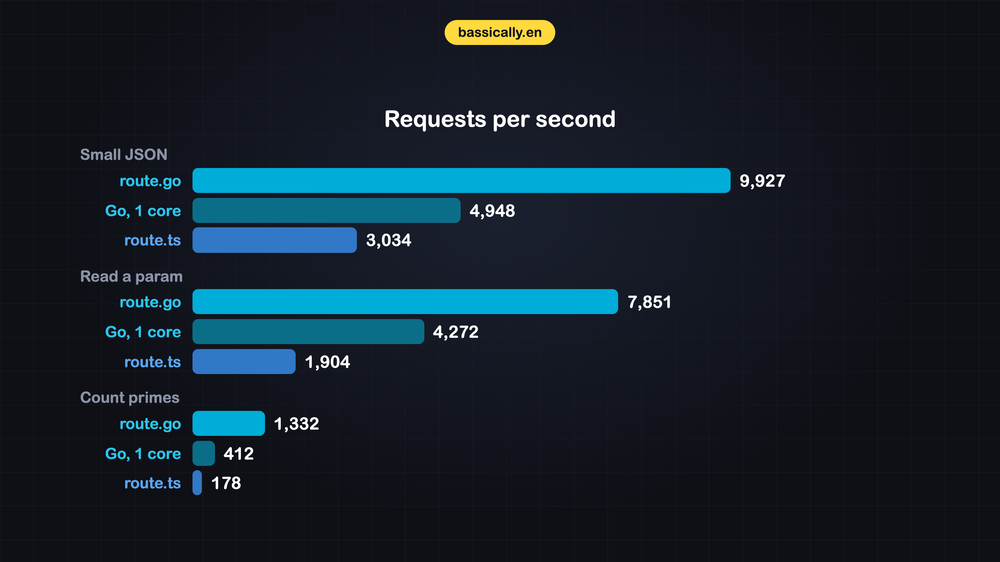
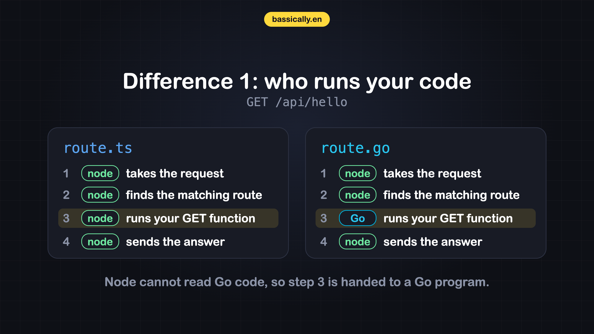

# 01 · Go Route Handlers in Next.js (`route.go`)

Next.js canary has an experimental flag that lets an App Router API route be a Go file. This folder has the same routes written twice, in Go and in TypeScript, and the scripts that measured them.

## Result

Requests per second, 50 connections for 15 seconds, `next start` on one machine:

| Route | Go | TypeScript | Go, one core |
|---|---:|---:|---:|
| `hello`: return a small JSON | **9,927** | 3,034 | 4,948 |
| `items/[id]`: read a param and a query, return JSON | **7,851** | 1,904 | 4,272 |
| `prime`: count primes below 100,000 (CPU work) | **1,332** | 178 | 412 |



What it costs:

| | |
|---|---|
| First request to a Go route | 20 to 35 ms (the worker starts then); 0.6 to 0.9 s the first time macOS runs a new binary. TypeScript: about 12 ms |
| Processes | One extra per Go route folder, started on its first request: 7 to 19 MB of memory and a 7.8 to 8.8 MB executable each. Node still runs in front (212 MB) |
| Build | Needs Go on the build machine. `output: 'standalone'`, static export, Webpack and cross-compiling are not supported |

One run each on a laptop, so read the gaps, not the last digit. Raw output: [`results/`](results/).

## How it works

```ts
// app/next.config.ts
const nextConfig: NextConfig = { experimental: { goRoutes: true } };
```

```go
// app/app/api/hello-go/route.go
package main

func GET(w http.ResponseWriter, r *http.Request) {
	w.Header().Set("Content-Type", "application/json")
	json.NewEncoder(w).Encode(map[string]string{"message": "Hello from Go!"})
}
```

No Next.js import: the handler is plain `net/http`. Node still takes every request and finds the matching route. It cannot read Go code, so it hands the one step of running your `GET` function to a Go program: Next.js compiles each Go route folder into an executable and starts it as a separate process next to Node. Routing and `proxy.ts` stay in Node.



## What was checked

| Check | Go | TypeScript | Where |
|---|---|---|---|
| Dynamic param, query string, JSON body, 400 on bad JSON | same answers | same answers | `results/behaviour.txt` |
| Unknown method → 405, `OPTIONS` → 204 with `Allow` | same | same | `results/behaviour.txt` |
| Streaming: three chunks, 200 ms apart | arrives chunk by chunk | not tested | `results/behaviour.txt` |
| A Go syntax error | fails `next build` with the file and line | | `results/compile-error.txt` |
| Workers when the server stops (TERM, INT, KILL) | all exit, none left behind | | `results/lifecycle.txt` |
| Environment variables | inherited from `next start` (`GOMAXPROCS=1` took effect) | | `results/one-core/behaviour.txt` |

## Run it

Needs Go 1.24+, pnpm and [`oha`](https://github.com/hatoo/oha).

```sh
cd app && pnpm install && cd ..
sh bench.sh                                      # build, check every route, load each pair
GOMAXPROCS=1 OUT=results/one-core sh bench.sh    # the same with Go held to one core
sh lifecycle.sh                                  # when workers start and stop
```

## Limits of this review

- One machine (Apple M1 Pro, 10 cores, macOS 26.6.2), Node v20.19.5, Go 1.27.4, Next.js 16.5.0-canary.57. One run per number.
- Node runs route handlers on one thread and Go uses every core. The "one core" column is the like-for-like comparison.
- Only self-hosted `next start` was tested. Nothing was deployed.
- The feature is experimental and can change. Its limits are listed in the [preview reference](https://preview.nextjs.org/docs/app/api-reference/file-conventions/route-go); it was added in [vercel/next.js#100130](https://github.com/vercel/next.js/pull/100130), merged on 2026-11-03.
