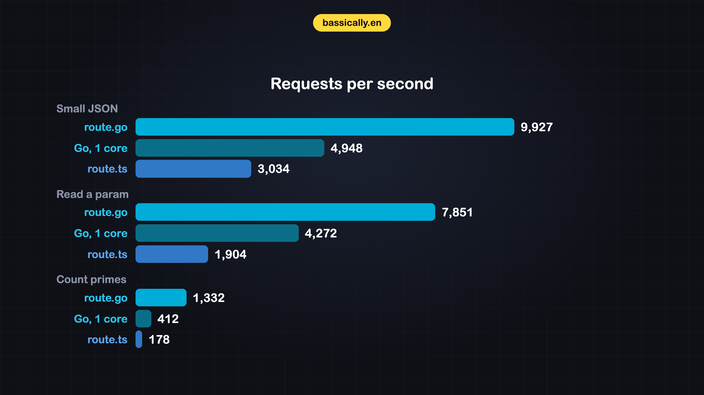
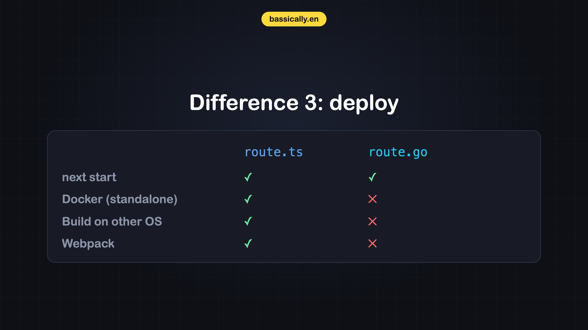
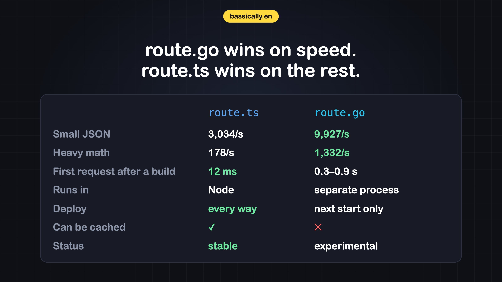

Short answer: `route.go` wins on speed, `route.ts` wins on everything else. For now, stay on `route.ts`.

## What I tried

Next.js canary has a new feature: an API route can be written as `route.go`. It was merged on 3 November 2026 and is still experimental.

I wrote three routes, each one twice: once as `route.ts`, once as `route.go`. Then I compared four things.

## Difference 1: who runs your code

Take one request, `GET /api/hello`. It goes through four steps:

1. Take the request from the browser.
2. Find the route that matches `/api/hello`.
3. Run the `GET` function you wrote.
4. Send the answer back.

With `route.ts`, Node does all four.

With `route.go`, Node still does steps 1, 2 and 4. It hands step 3 to a Go program, because Node cannot read Go code.

So each Go route is one more program running next to Node. After I called three Go routes, the machine was running four processes: Node, plus one per Go route (9, 12 and 19 MB).

## Difference 2: speed

`route.go` answered about 3 times more requests for a small JSON: 9,927 per second against 3,034.

For heavy math the gap is 7 times. Part of that is Go using every core while Node runs on one thread. Even on one core, Go is still 2 times faster.

## Difference 3: deploy

`route.ts` runs every way Next.js can be deployed.

`route.go` today only runs with `next start`, on a machine with the same operating system as the build machine. `standalone` output, the one usually used for Docker, is not supported.

## Difference 4: features

- **Caching.** `route.ts` can be cached. `route.go` always runs again.
- **First request.** `route.ts` takes about 12 ms. `route.go` takes 20 to 35 ms, because its process only starts then.
- **Status.** `route.ts` is stable. `route.go` is experimental and can still change.

## Conclusion

| | `route.ts` | `route.go` |
|---|---|---|
| Small JSON | 3,034 requests/s | **9,927 requests/s** |
| Heavy math | 178 requests/s | **1,332 requests/s** |
| First request | **12 ms** | 20–35 ms |
| Your code runs in | Node | a Go program, one per route |
| Deploy | **every way** | `next start` only |
| Can be cached | **yes** | no |
| Status | **stable** | experimental |

Which one to use?

- **Almost every route: `route.ts`.**
- **One heavy route: `route.go`**, but later, once the feature is stable.

## How it was measured

50 connections for 15 seconds per route, `next start`, one laptop (Apple silicon, 10 cores), one run. So read the gaps, not the last digit. The deploy and caching limits come from the documentation; I did not test them myself.

## Code

Every route, the scripts and the raw results: [github.com/haryarrahman14/tech-reviews](https://github.com/haryarrahman14/tech-reviews), folder `01-nextjs-go-routes`.

## Sources

- [`route.go` reference](https://nextjs.org/docs/app/api-reference/file-conventions/route-go), Next.js documentation
- [vercel/next.js#100130](https://github.com/vercel/next.js/pull/100130), the pull request that added the feature
